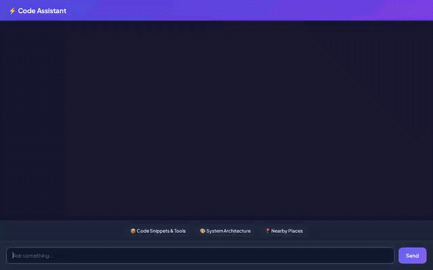

# CodeAssistant

A conversational developer AI assistant built with Google's **Agent Development Kit (ADK)** and powered by **Gemini**. CodeAssistant helps software developers search and manage reusable code snippets, generate system architecture flowcharts and video animations, fetch live package and repository metadata, execute Python code securely, and persist developer preferences across sessions.



---

## 🌟 Implemented Features & Google Cloud Services

Based on the core implementation in `app/` and `agents-cli-manifest.yaml`, CodeAssistant integrates the following capabilities:

### 1. Vertex AI Memory Bank (Cross-Session Memory)
- **Persistent Preferences**: Stores developer preferences, preferred languages, and personal constraints across sessions using `PreloadMemoryTool` and post-turn session extractions (`add_session_to_memory`).

### 2. Firestore Code Snippet Repository
- **Snippet Catalog**: Browse, fetch, and save reusable code snippets, design patterns, and middleware implementations directly in Google Cloud Firestore (`list_code_snippets`, `get_code_snippet`, `save_code_snippet`).

### 3. Architecture Diagram & Video Generation (Cloud Storage)
- **Diagram Generation**: Generates high-quality architecture diagrams and system flowcharts using Vertex AI / Gemini Image models (`generate_architecture_diagram`).
- **Domain Video Animations**: Generates developer concept video animations via Google's Omni model (`gemini-omni-flash-preview` in `generate_domain_video`).
- **Cloud Storage (GCS) Hosting**: Media artifacts are uploaded to a public Cloud Storage bucket (`code-assistant-media-ebc9cd`) and returned as public HTTPS URLs for inline UI rendering.

### 4. A2UI Protocol & Custom Web Interface
- **Agent-to-UI Protocol**: Emits structured A2UI payloads (Cards, Columns, Rows, Text, Images) handled by a custom dark-slate chat interface featuring interactive prompt chips (`frontend/static/index.html`).

### 5. Secure Code Execution Sandbox
- **Agent Engine Sandbox**: Executes Python snippets securely in an isolated environment (`AgentEngineSandboxCodeExecutor`).

### 6. Live Developer Tools & External APIs
- **PyPI Package Metadata**: Fetches real-time package summaries, versions, and dependencies from PyPI (`fetch_pypi_package_info`).
- **GitHub Repository Stats**: Retrieves real-time star counts, forks, open issues, and topic tags from public GitHub repositories (`fetch_github_repo_info`).
- **Google Maps Geocoding & Places**: Resolves address coordinates (`geocode_address`) and finds nearby developer spots or cafes (`find_nearby_places`).

---

## 📋 Feature Status

| Feature | Status |
| :--- | :--- |
| Cross-Session Memory (Vertex AI Memory Bank) | ✅ Implemented |
| Firestore Snippet Storage | ✅ Implemented |
| Cloud Storage Media Hosting | ✅ Implemented |
| Gemini Architecture Diagram Generation | ✅ Implemented |
| Gemini Omni Video Generation | ✅ Implemented |
| A2UI Protocol UI Cards & Custom Web UI | ✅ Implemented |
| PyPI & GitHub Live Metadata Tools | ✅ Implemented |
| Google Maps Geocoding & Places Tools | ✅ Implemented |
| Agent Engine Code Sandbox Execution | ✅ Implemented |
| Cloud Trace Custom Telemetry | ⏳ Planned, not yet implemented |
| Direct Git CLI Local Integration | ⏳ Planned, not yet implemented |

---

## 📁 Project Structure

```
code-assistant/
├── app/
│   ├── agent.py               # Main ADK root agent configuration & callbacks
│   ├── tools.py               # Firestore, GCS, Diagram, PyPI, and GitHub tools
│   ├── a2ui_utils.py          # A2UI model callback renderer
│   └── fast_api_app.py        # FastAPI A2A backend entry point
├── frontend/                  # Web chat interface
│   ├── static/index.html      # Custom dark-themed chat UI with quick prompts
│   ├── main.py                # FastAPI proxy forwarding A2A requests to Agent Engine
│   └── pyproject.toml         # Frontend service dependencies
├── demo.gif                   # Looping video demo of CodeAssistant
├── agents-cli-manifest.yaml   # Manifest for ADK deployment
└── pyproject.toml             # Python dependencies and uv settings
```

---

## ⚙️ Local Setup & Execution Instructions

### Prerequisites
- **uv**: Fast Python package manager
- **google-agents-cli**: Installed via `uv tool install google-agents-cli`
- **Google Cloud SDK**: Configured with project credentials

### Step 1: Install Dependencies
```bash
agents-cli install
```

### Step 2: Run the Agent Backend
You can launch the backend using `agents-cli` or `uv`:

```bash
# Option A: Run via agents-cli playground
agents-cli playground

# Option B: Run FastAPI A2A server directly
uv run python -m app.fast_api_app
```

### Step 3: Run the Web Frontend
In a separate terminal, start the custom chat frontend:

```bash
cd frontend
uv run python main.py
```

Open your browser to the local server address output by the command (typically `localhost` on port `8080`) to interact with CodeAssistant.

---

## 🚀 Cloud Deployment

### Deploy Agent Engine
```bash
gcloud config set project <YOUR_GCP_PROJECT_ID>
agents-cli deploy
```

### Deploy Frontend to Cloud Run
```bash
cd frontend
gcloud run deploy code-assistant-frontend \
  --source . \
  --region us-central1 \
  --allow-unauthenticated \
  --set-env-vars AGENT_ENGINE_RESOURCE_NAME="<YOUR_AGENT_RESOURCE_NAME>",AGENT_DIRECTORY="app"
```
